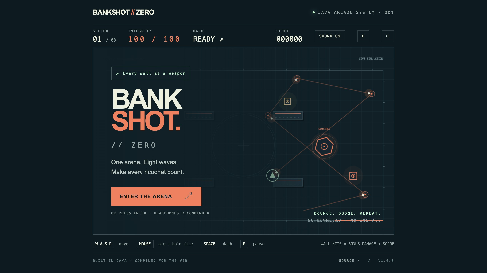

# BANKSHOT // ZERO

[Play on itch.io](https://trenn1x.itch.io/bankshot-zero) · [Play on GitHub Pages](https://trenn1x.github.io/bankshot-zero/) · [Download a release](https://github.com/Trenn1x/bankshot-zero/releases)



A neon projectile arena shooter written in Java. Bounce shots off the arena, weave through enemy fire, and build a loadout between waves.

The game engine and Canvas renderer are Java. [TeaVM](https://teavm.org/) compiles them to JavaScript so the release plays directly in a desktop browser, including on itch.io. Players do not need Java installed.

## Controls

| Input | Action |
| --- | --- |
| WASD / arrow keys | Move |
| Mouse | Aim |
| Hold left mouse button | Fire |
| Space | Dash |
| 1 / 2 / 3 | Choose an upgrade between waves |
| P / Escape | Pause |
| M | Toggle sound |
| Enter / R | Start; restart after a run |

Use a keyboard and mouse. Click inside the game to give it keyboard focus and enable sound.

## Build and play

Install **JDK 21+** and **Maven 3.9+**. Set `JAVA_HOME` if Java is not on your path. The scripts also recognize a JDK and Maven unpacked into the ignored `.tools/` directory.

```bash
./scripts/build.sh
./scripts/serve.sh
```

Open **http://127.0.0.1:8080**. Python 3 is used only by the local preview server. Choose another port with `PORT=8081 ./scripts/serve.sh`.

The build runs the headless Java engine regression tests, compiles the browser game, then creates:

- `dist/web/` — the complete static game.
- `dist/bankshot-zero-web.zip` — the itch.io upload, with `index.html` at its root.

To run only the engine tests:

```bash
./scripts/mvn.sh --batch-mode --no-transfer-progress test
```

## Project

- `src/main/java/game/Engine.java` — simulation and projectile collision rules.
- `src/main/java/game/WebGame.java` — browser input, rendering, and audio.
- `src/test/java/game/EngineTest.java` — headless regression checks.
- `web/` — responsive browser shell.
- `scripts/` — build, packaging, and local preview commands.
- `.github/workflows/` — test/build, tagged releases, and GitHub Pages publishing.

GitHub Actions rebuilds and tests every push to `main` and each pull request. The Pages workflow publishes `dist/web/` after the repository is configured to use **GitHub Actions** as its Pages source. A `v*` tag creates a GitHub Release with the browser ZIP.

See [release instructions](docs/RELEASING.md) for GitHub and itch.io publication, and [itch.io page copy](docs/ITCH_PAGE.md) for the store listing.

Game source is MIT licensed. Copyright © 2026 Thomas Verdier. TeaVM's generated runtime is covered by its [Apache 2.0 license](docs/licenses/TeaVM-LICENSE.txt) and [notices](docs/licenses/TeaVM-NOTICE.txt), included in the browser release.
